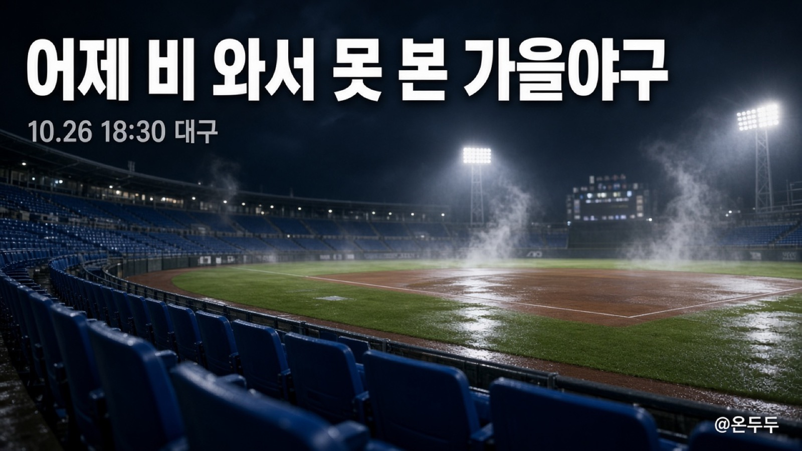

어제 대구에 비만 오고 야구는 없었어요. 1차전 보려고 시간 비워뒀는데 우천 취소. 오늘은 저녁 6시 반에 같은 자리에서 다시 합니다. 삼성 홈, KIA 원정.

내가 지금 필요한 건 승부 예측이 아니라, 이번 주에 언제 TV를 켜면 되는지만이었어요. 그래서 달력만 다시 보고 적어봅니다. 숫자는 [KBO 일정](https://www.koreabaseball.com/Schedule/Schedule.aspx)이랑 [10월 7일 보도자료](https://www.koreabaseball.com/MediaNews/Notice/View.aspx?bdSe=12183) 기준이에요. 비 한 번 더 오면 또 밀리니까, 그날 아침에 한 번만 다시 보면 됩니다.

와일드카드는 허무하게 끝났어요. 10월 14일 잠실에서 LG가 두산을 4-1로 이겼고, 4위는 한 경기만 이기거나 비겨도 올라가서 이틀째는 아예 안 열렸습니다. 두산 팬 입장에선 가을이 하루 만에 닫힌 느낌이죠.

그다음 준플레이오프는 KIA가 LG를 그냥 밀어버렸습니다. 광주에서 5-1, 6-3, 잠실에서 13-1. 3연승이면 이야기가 길 필요가 없어요. 그래서 지금 남은 그림은 단순합니다. 삼성하고 KIA가 다섯 판 하고, 이긴 팀이 수원에서 KT를 만나요. KT는 1위로 한국시리즈 직행이라 이번 주는 그냥 지켜보는 쪽입니다.

오늘 선발은 어제 예고 그대로라는 말이 많아요. 삼성 페덱, KIA 네일. 비 와서 하루 쉰 김에 바꾸지 않은 거죠. 중계는 오늘만 MBC랑 티빙이라고 나와 있고, 내일부터는 그날 일정표 TV 칸을 보는 게 속 편합니다.

1차전이 하루 밀려서 뒤도 같이 밀렸어요.

- 오늘 26일 저녁 6:30, 대구
- 내일 27일 같은 시간, 또 대구
- 수요일은 이동일. 야구 없음
- 목·금은 광주, 둘 다 저녁 6:30
- 어느 팀이 먼저 세 번 이기면 끝. 5차전이 필요하면 11월 1일 대구로 보는 이야기가 있어요

다섯 판까지 갈지는 오늘 한 판 보고 생각하려고요. 그래도 수요일엔 쉴 수 있어서, 그게 제일 좋아요.

한국시리즈는 원래 11월 2일 수원에서 열리게 짜여 있어요. 1·2차전 수원, 한 하루 쉬고, 3·4·5차전은 올라온 팀 홈, 또 하루 쉬고, 6·7차전 다시 수원. 주중은 저녁 6시 반, 토요일만 오후 2시. 작년처럼 2-3-2예요.

다만 플레이오프가 일요일까지 가면 2일 개막이 그대로일지 좀 애매해집니다. 시리즈 사이에 이동일을 하루는 넣거든요. 그래서 나는 캘린더에 “한국시리즈 = 11월 2일”이라고 박아두지 않았어요. 그때 되면 KBO가 한 줄 더 올릴 거예요.

표 살 사람은 구단 앱 말고 [NOL 티켓](https://nol.yanolja.com/ticket)이에요. 한 경기에 네 장까지. 플레이오프 예매는 이미 21일 오후 2시에 열렸고, [그때 공지](https://www.koreabaseball.com/MediaNews/Notice/View.aspx?bdSe=12210)에 그렇게 적혀 있습니다. 어제 취소된 표가 어떻게 되는지는 예매 문자나 NOL 안내를 보는 게 맞아요. 현장 표는 경기 두 시간 전부터 나온다고 하고, 65세 이상·장애인·외국인은 매표소에서 한 장.

한국시리즈 오픈 시간을 21일 2시랑 같다고 생각하면 안 됩니다. 대진 정해진 뒤에 공지가 따로 나와요. 나는 표 노릴 때 [KBO 공지 목록](https://www.koreabaseball.com/MediaNews/Notice/List.aspx)만 가끔 열어봐요.

비 오면 다음 날로 넘기고, 이번 가을엔 노게임 없이 서스펜디드만 쓴다고 합니다. 연장은 15회까지. 그 부분은 직관 가는 사람만 기억하면 되고, 집에서 볼 사람은 오늘 저녁 대구만 켜두면 됩니다.
