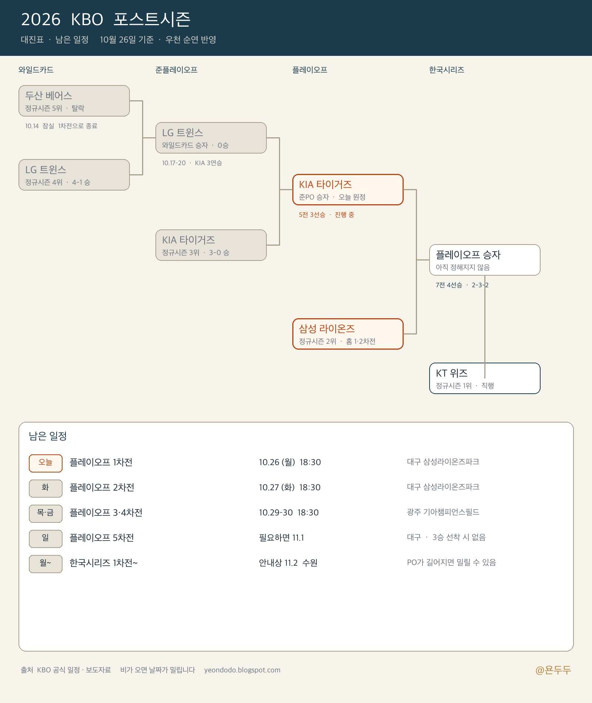

오늘(10월 26일) 저녁 6시 30분, 대구 삼성라이온즈파크에서 플레이오프가 다시 열린다. 어제는 비가 와서 1차전이 취소됐다. TV를 켜기 전에 남은 일정만 적어 두려고 한다.

숫자는 [KBO 보도자료](https://www.koreabaseball.com/MediaNews/Notice/View.aspx?bdSe=12183)와 [경기일정](https://www.koreabaseball.com/Schedule/Schedule.aspx)을 기준으로 봤다. 비가 한 번 더 오면 날짜가 밀린다. 경기 직전에는 그 두 페이지를 다시 여는 게 맞다.

## 누가 남았나

정규시즌은 이렇게 끝났다. 1위 KT, 2위 삼성, 3위 KIA, 4위 LG, 5위 두산.

와일드카드는 짧았다. 10월 14일 잠실에서 LG가 두산을 4-1로 이겼고, 4위는 한 경기만 이기거나 비겨도 올라가서 2차전은 열리지 않았다.

준플레이오프는 KIA가 LG를 3연승으로 끝냈다. 광주에서 5-1, 6-3, 잠실에서 13-1. 그래서 지금 남은 대진은 단순하다.

- **플레이오프**: 삼성 vs KIA, 5전 3선승
- **한국시리즈**: 1위 KT가 기다린다. 상대는 위 시리즈 승자. 7전 4선승

KT는 이번 주를 쉰다. 삼성·KIA는 오늘부터 붙는다.

## 이번 주, 플레이오프

1차전이 하루 밀리면서 뒤 경기도 하루씩 밀렸다. 보도 기준으로 보면 이렇게 남아 있다.

| 차전 | 날짜 | 시간 | 구장 |
| --- | --- | --- | --- |
| 1차전 | 10월 26일(월) | 18:30 | 대구 |
| 2차전 | 10월 27일(화) | 18:30 | 대구 |
| 이동일 | 10월 28일(수) | — | — |
| 3차전 | 10월 29일(목) | 18:30 | 광주 |
| 4차전 | 10월 30일(금) | 18:30 | 광주 |
| 5차전 | 필요하면 11월 1일(일) | 확인 필요 | 대구 |

5차전은 어느 팀이 먼저 3승을 하면 없다. 오늘 1차전 중계는 MBC와 티빙이라는 안내가 나와 있다. 다음 경기 채널은 일정표의 TV 칸을 보면 된다.

선발은 어제 예고 그대로라는 이야기가 많다. 삼성 페덱, KIA 네일. 우천 취소 뒤에도 바꾸지 않았다는 뜻이다. 선발은 경기 시작 전에 구단·중계 화면이 최종이다.

## 한국시리즈는 아직 11월 2일 자리

KBO가 처음 짠 한국시리즈 뼈대는 이렇다. 주중은 보통 18:30, 토요일은 14:00.

| 차전 | 날짜 | 홈 |
| --- | --- | --- |
| 1·2차전 | 11월 2일(월), 3일(화) | 수원 (KT) |
| 이동일 | 11월 4일(수) | — |
| 3·4·5차전 | 11월 5~7일 | 플레이오프 승자 홈 |
| 이동일 | 11월 8일(일) | — |
| 6·7차전 | 11월 9일(월), 10일(화) | 수원 (KT) |

홈은 지난해부터 쓰던 2-3-2다. KT가 1·2·6·7차전, 플레이오프에서 올라온 팀이 3·4·5차전.

여기가 헷갈리는 지점이다. 시리즈 사이에는 이동일을 하루 이상 넣는다. 플레이오프가 11월 1일 5차전까지 가면, 안내상 11월 2일 개막이 그대로일지 밀릴지 공식 일정이 한 번 더 움직인다. “한국시리즈는 무조건 2일”이라고 캘린더에 고정해 두지 않는 편이 낫다.

비로 경기가 안 열리면 다음 날로 넘긴다. 노게임·강우콜드는 이번 포스트시즌에 쓰지 않고, 서스펜디드만 쓴다. 연장은 15회까지, 그래도 안 나면 무승부다. 와일드카드를 뺀 시리즈에서 무승부가 나면 그 시리즈가 끝난 뒤 같은 구장에서 하루 더 붙는다.

## 표는 어디서 사나

포스트시즌 표는 구단 앱이 아니라 [NOL 티켓](https://nol.yanolja.com/ticket) 한곳이다. 웹, 앱, 고객센터 1544-1555. 한 경기에 1인 4매가 상한이다.

플레이오프 예매는 10월 21일 오후 2시에 열렸다. [KBO 예매 공지](https://www.koreabaseball.com/MediaNews/Notice/View.aspx?bdSe=12210)에 그렇게 적혀 있다. 어제 우천 취소분이 있으면 표 효력은 NOL·KBO 안내를 따른다. 취소표가 나오면 경기 시작 2시간 전부터 구장 현장 판매가 있다. 만 65세 이상(1962년 1월 1일 이전 출생), 장애인, 외국인은 매표소에서 1인 1매.

한국시리즈 차전별 오픈 시각은 아직 플레이오프 예매일과 같다고 보면 안 된다. 대진이 정해진 뒤 보도자료가 따로 나온다. 21일 2시를 수원에 그대로 대입하지 말 것.

필요 없는 경기가 안 열리면 그 표는 보통 수수료 없이 취소된다. 이것도 예매 화면 환불 문구가 우선이다.

## 내가 보는 순서

1. 오늘 저녁은 대구 1차전만 보면 된다.
2. 수요일은 이동일이다. 목·금은 광주.
3. 한국시리즈 표를 노리면, 예매 공지가 뜨는지 [KBO 미디어/뉴스](https://www.koreabaseball.com/MediaNews/Notice/List.aspx)만 가끔 연다.
4. 날짜가 의심스러우면 포털 그래픽보다 [KBO 일정](https://www.koreabaseball.com/Schedule/Schedule.aspx)을 연다.

점수 이야기나 승부 예측은 여기 적지 않는다. 비 온 다음날 필요한 건 누가 이기느냐보다, 언제 어디서 열리는지다.
